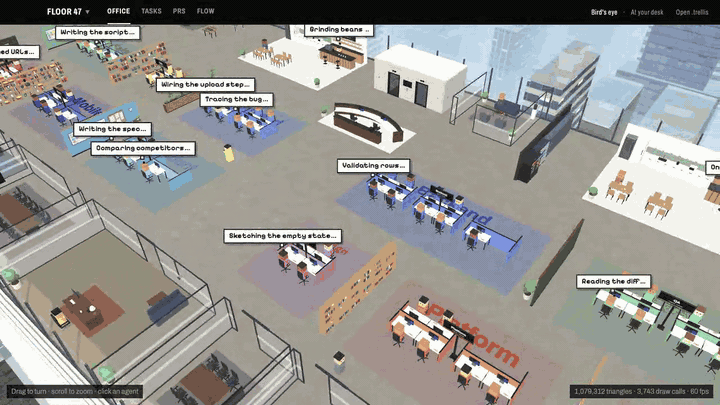
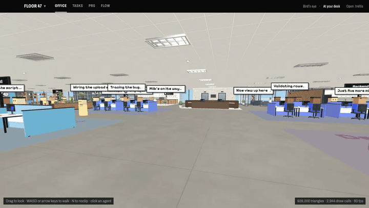
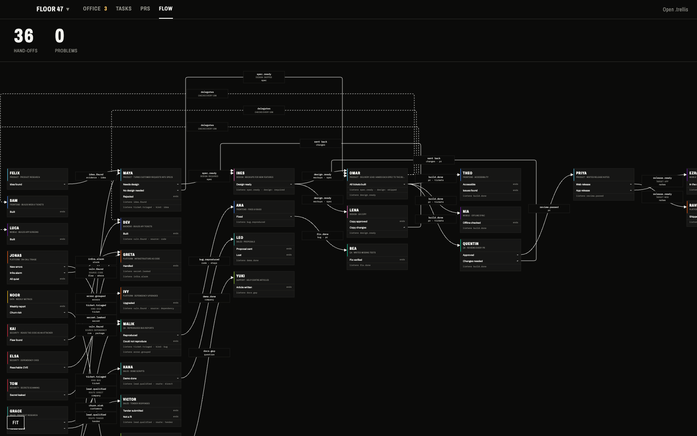

# Overview
AI is here to stay and has absolutely changed the way we work as software developers. In a matter of years, it's become an essential skill to be able to use AI tools to assist in development. What does the future look like? I don't think anyone knows for sure. However, I have been embracing AI in my development workflow for a long time now. Quite frankly I love it and it's become part of my workflow.

The problem I've had? I'm never working on just 1 problem at a time and most of my workflows follow quite a rigid structure: Analyze the problem, create requirements, design a solution, design a technical specification, implement the solution across multiple agents, QA, prep for release, and finally release. Juggling multiple Claude Code sessions has been a complete pain in the arse. Hence, I created Trellis. A "satirical but useful" tool to manage multiple agents in a single, interactive interface.




# What Trellis Does?
My work is a mix of sequential and ad-hoc. Some of it follows the structure above, where one agent finishes and the next one picks it up: requirements, spec, implementation, QA and so on. The rest is random: a bug that needs fixing, a PR that needs reviewing, a ticket that needs writing up. Trellis handles both.

The whole point? I don't want to babysit it. Once an agent has its work, it gets on with it. The only time I get involved is when an agent has an issue, needs a decision, wants to do something risky or gets stuck. 

Trellis allows you to specify agents as you would do in any project using Claude Code but rather, you add your agents into departments

```
.trellis/
  trellis.yaml
  departments/<team>/department.yaml   name, colour, order
  departments/<team>/agents/<key>.md   front matter + prompt body
```

So why not just write one big agent file? You can write "research the ticket, draft the spec, save it to Linear, then hand it to QA" into a single `.claude/agents` file and Claude will usually follow it...Well "Usually" is the key. Those instructions are only a request. An agent can quite simply ignore instructions, skipping the research, saving to Linear before I've read the draft, forgetting the hand-off, or stopping halfway with "let me know if you'd like me to continue". And every stage of the work piles into the same session and the same context.

A Trellis agent still has a prompt body like any other agent file. The difference is the front matter, which Trellis enforces rather than the model:

```yaml
permissions:
    free:
        - Read
        - linear/get_issue
    ask:
        - linear/save_issue
steps:
    - Research
    - Draft
    - name: Save
      tools:
          - linear/save_issue
outcomes:
    - name: saved
      label: Spec saved
      publish: spec.done
      fields:
          issue: Link to the Linear issue
```

* **Steps are checked.** A tool pinned to a step only works during that step, so the agent can't save to Linear while it's still drafting
* **Permissions are per agent.** Least permission principle for agents? Nice
* **Endings are fixed.** The agent has to finish with one of its outcomes and report the fields that outcome needs
* **Hand-offs aren't left to the agent.** It finishes and Trellis automatically passes the outcome to whichever agent is listening for it, in any department, which starts with a clean context and a new prompt 
* **Every job runs separately.** Each one is its own Claude Code process with its own context and, where it needs one, its own git worktree. Ten jobs can run side by side without stepping on each other.

A big agent file describes the process and hopes the model follows it. Trellis makes the process the only path the agent can take.




# Limitations
* Only works with Claude Code (for now)
* Only works with Linear

# Resources
GitHub Repository: [https://github.com/rexchoppers/trellis](https://github.com/rexchoppers/trellis)